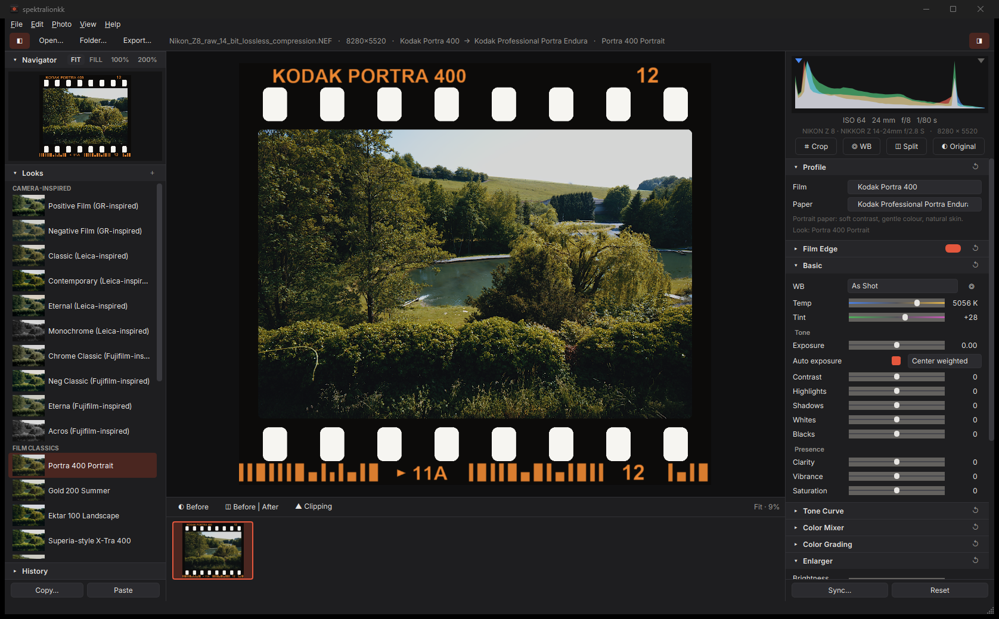
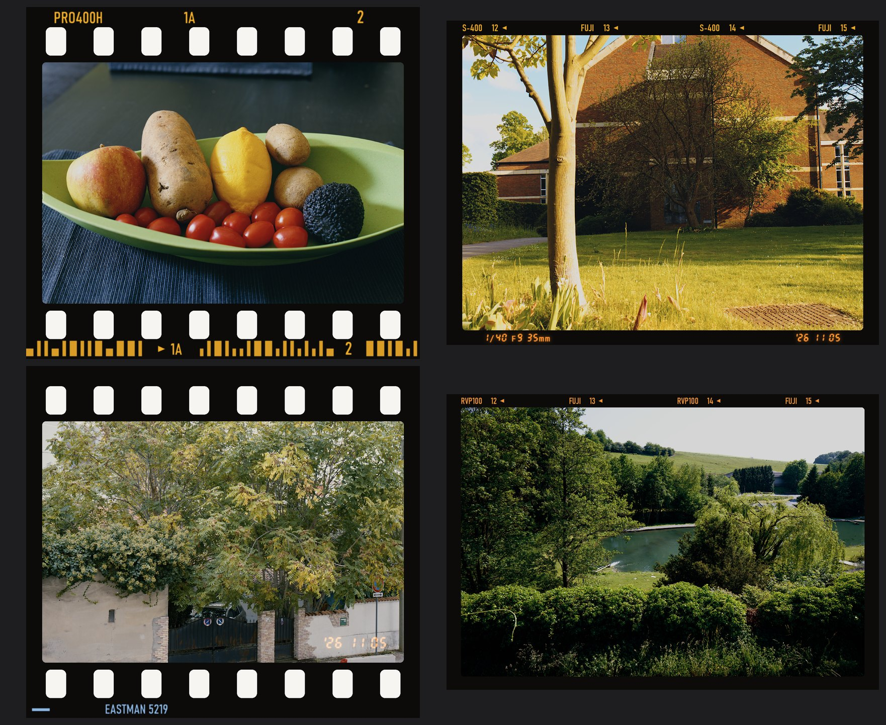

# spektralionkk

**Spectral film & print simulation for Windows and macOS.** Open a RAW, pick a film and a paper, and get a physically
modelled print — light traced through the film's dye layers, the enlarger's filter pack and the paper — with
grain, halation and DIR couplers, in a Lightroom-style editor. Built on the
[spektrafilm](https://github.com/andreavolpato/spektrafilm) engine by Andrea Volpato.

English · [简体中文](README.zh-CN.md)

<p align="center">
  <a href="https://github.com/Donji-zzZ/spektralionkk/releases/download/v1.4.0/spektralionkk-1.4.0-setup.exe"></a>
  &nbsp;
  <a href="https://github.com/Donji-zzZ/spektralionkk/releases/download/v1.4.0/spektralionkk-1.4.0-macos-arm64.dmg"></a>
</p>
<p align="center">
  <b>Windows</b> 10 / 11, 64-bit · 124 MB &nbsp;&nbsp;|&nbsp;&nbsp; <b>Mac</b> with Apple silicon (M1 or newer), macOS 14+ · 161 MB<br>
  Version 1.4.0 · <a href="#macos">How to open it on a Mac</a> · <a href="https://github.com/Donji-zzZ/spektralionkk/releases">All versions</a>
</p>



## Features

- **Film and paper, simulated spectrally** — 25 films (colour negative, slide, cinema, black-and-white) and
  9 papers / print films plus direct scan, and a "Digital" profile without film. Grey prints neutral on
  every film and paper; the materials give the look.
- **Real-time sliders on any CPU** — exposure, white balance, film, paper, tone, curves, HSL, colour grading
  and LUTs update in a few milliseconds from lookup tables; the full-quality render (grain, halation,
  couplers, sharpening) follows when you let go. No graphics card needed.
- **Film Edge and date back** — print the film strip around the picture, to scale: 135 with perforations,
  the stock's own edge print (camera-inspired looks print their own name), frame numbers and DX code; 120
  with its rebate lettering; half frame, XPan,
  645, 6×6 … 6×17 and 4×5 gates. An orange LED date in the picture (135) or in the film margin with
  shooting data (120). Filed carrier, slide mount and white borders too.
- **Editing** — white balance (as shot, auto, presets, picker), tone, presence, tone curves, HSL mixer,
  colour grading, vignette, crop & straighten, history, before / after, clipping, drag on the histogram.
- **Looks and presets** — 26 built-in looks; import Lightroom / Camera Raw presets (`.xmp`, `.lrtemplate`)
  and `.cube` LUTs; export your own as `.sprkpreset`.
- **Library** — filmstrip with ratings, pick / reject flags and filters; copy / paste / sync settings;
  apply looks to many photos.
- **RAW** — via LibRaw, including lossless and lossy compressed RAW (Sony, Canon CR3 / C-RAW, Fujifilm,
  Nikon, Panasonic, DNG). For codecs LibRaw cannot decode yet (Nikon High Efficiency, JPEG XL DNG) the
  camera's embedded full-size JPEG is used, and the app says so.
- **Export** — JPEG, TIFF 16 / 8-bit, PNG in sRGB, Display P3, Adobe RGB, ProPhoto or Rec.2020, with or
  without the film frame. Runs in the background with a progress bar in the top bar; a 42 MP RAW takes
  about 40 s on a 12-core desktop CPU.
- **English and 简体中文** — chosen in the Windows installer (on a Mac: the system language), switchable
  under View ▸ Language.



## Download

Everything is on the [Releases](../../releases) page.

### Windows

`spektralionkk-<version>-setup.exe` — Windows 10 / 11, 64-bit, any Intel or AMD CPU. The first start compiles
the processing kernels (about 30 s, once). `spektralionkk.exe --selftest` (also in the Start menu) checks a PC.

### macOS

`spektralionkk-<version>-macos-arm64.dmg` — a Mac with Apple silicon (M1 or newer) and macOS 14 Sonoma or
later. Intel Macs are not supported: the compiler the film engine relies on (numba) no longer ships for them.

1. Open the `.dmg` and drag **spektralionkk** onto **Applications**.
2. Open spektralionkk from Applications or Launchpad.
3. The first time, macOS may say *"spektralionkk" Not Opened* — the app is free and not registered with
   Apple, so macOS asks you to confirm it once: click **Done**, open **System Settings ▸ Privacy & Security**,
   scroll down to *"spektralionkk" was blocked…* and click **Open Anyway**, then confirm with your password.
   On macOS 14 you can also Control-click the app and choose **Open**. Or, in Terminal:

   ```bash
   xattr -dr com.apple.quarantine /Applications/spektralionkk.app
   ```

4. The first start prepares the film engine (about a minute, once); after that it starts in seconds.

Add photos with File ▸ Open, by dragging them (or a folder) onto the window or the Dock icon, or with
Finder's **Open With ▸ spektralionkk**. Builds signed with an Apple Developer ID (see *Build for macOS*) open
with a plain double-click, without step 3. To check a Mac:
`/Applications/spektralionkk.app/Contents/MacOS/spektralionkk --selftest` in Terminal.

## Build from source

`requirements.txt` pins spektrafilm to the commit this release was tested with. Git is not needed for the
dependencies.

### Windows

Requirements: Windows 10 / 11 x64, [Python 3.13](https://www.python.org/downloads/) (64-bit), and
[Inno Setup 6](https://jrsoftware.org/isinfo.php) for the installer.

```powershell
py -3.13 -m venv .venv
.venv\Scripts\python.exe -m pip install -r requirements.txt -r requirements-build.txt

# run from source
cd app
..\.venv\Scripts\python.exe -m spektralionkk
cd ..

# build the app (dist\spektralionkk\) and the installer (release\)
.\build.ps1
```

### macOS

Requirements: a Mac with Apple silicon, macOS 14+, and [Python 3.13](https://www.python.org/downloads/)
(python.org or Homebrew).

```bash
python3.13 -m venv .venv
.venv/bin/pip install -r requirements.txt -r requirements-build.txt

# run from source
(cd app && ../.venv/bin/python -m spektralionkk)

# build the app (dist/spektralionkk.app) and the disk image (release/)
bash scripts/build_macos.sh
```

**No Mac? Let GitHub build it.** [`.github/workflows/build.yml`](.github/workflows/build.yml) runs on GitHub's
Apple-silicon Macs: publish a release and the `.dmg` is attached to it about 20–30 minutes later, or start it
any time under **Actions ▸ Build ▸ Run workflow** and download the file from the run's *Artifacts*.

**Opening with a double-click.** Without an Apple Developer ID the app is signed ad hoc and macOS asks people
to confirm it once (step 3 above). With a Developer ID ($99 a year) the build script signs and notarises it:
set `MACOS_SIGN_IDENTITY` and `APPLE_ID` / `APPLE_TEAM_ID` / `APPLE_APP_PASSWORD` when running
`scripts/build_macos.sh`, or add them as repository secrets for the workflow (the list is at the top of
`build.yml`).

## Tests

```powershell
.\scripts\run_tests.ps1                                   # all suites, headless
.\scripts\run_tests.ps1 -RawFile D:\photos\DSC01234.ARW   # plus a full-resolution test on one of your RAWs
```

On a Mac: `bash scripts/run_tests.sh` (and `bash scripts/run_tests.sh ~/Pictures/DSC01234.ARW`).

`test_rawformats` runs when sample RAW files are present in `rawsamples\<format>\` (for example from
[raw.pixls.us](https://raw.pixls.us/), CC0) or in the folder named by `SPRK_RAWSAMPLES`.

## Project layout

```
app/
  launcher.py               entry point of the packaged app (and --selftest)
  spektralionkk/            the application package
    engine.py               decode, white balance, geometry, preview and full-resolution renders
    live.py                 real-time preview (lookup tables + one compiled kernel)
    fastprint.py            baked print + scan stage for full-resolution renders
    grainfast.py            fast film grain with spektrafilm's statistics
    borders.py              Film Edge, date back and print borders
    finish.py               tone, presence, colour grading, HSL, curves, LUTs
    presets.py, luts.py     Lightroom preset and .cube LUT import
    numba_guard.py          keeps rendering threads safe on every numba threading layer (macOS)
    platform_util.py        data folder and "Show in Explorer / Finder" per system
    i18n.py                 English / Simplified Chinese
    ui/                     PySide6 interface
    data/                   extra film / paper profiles, Inter font
  tests/                    test suites (scripts/run_tests.ps1, scripts/run_tests.sh)
  spektralionkk_app.spec    PyInstaller build (Windows)
  spektralionkk_mac.spec    PyInstaller build (macOS app bundle)
  macos/                    entitlements, disk-image layout and background
installer/                  Inno Setup script and Chinese installer messages
build.ps1                   build the Windows app and installer
scripts/build_macos.sh      build the macOS app and disk image
.github/workflows/build.yml build on GitHub (macOS disk image; Windows installer on request)
```

## Credits

- **[spektrafilm](https://github.com/andreavolpato/spektrafilm)** by Andrea Volpato — the film simulation
  engine (GPL-3.0) and the colour film and paper profiles (CC BY-SA 4.0). The heart of this app.
- Thanks to **SpektraLab** for the black-and-white film and Ilford Multigrade paper data.
- **Inter** typeface by Rasmus Andersson (SIL Open Font License).
- Example photos in this README: sample RAW files from [raw.pixls.us](https://raw.pixls.us/) (CC0).

Details and licences: [THIRD_PARTY_NOTICES.md](THIRD_PARTY_NOTICES.md). Film, camera and brand names are
trademarks of their owners and only identify data, formats or inspiration; the camera-inspired looks are
approximations, not manufacturer profiles.

## Licence

GNU General Public License v3.0 — see [LICENSE](LICENSE).
