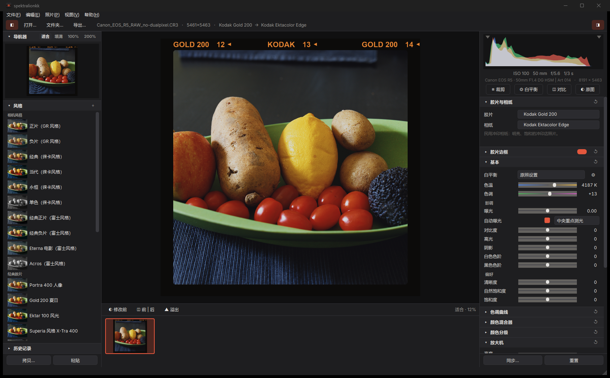
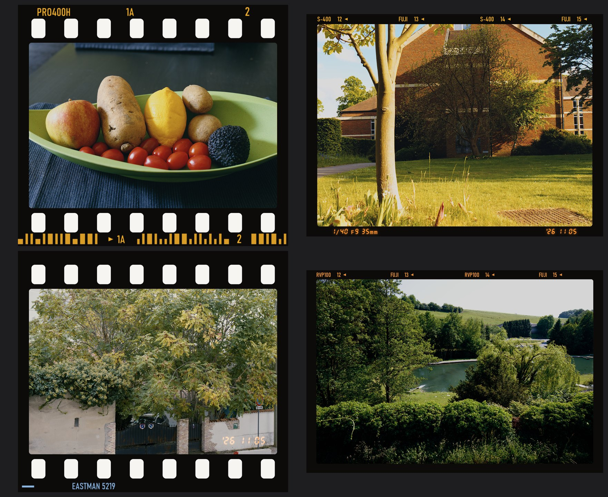

# spektralionkk

**Windows 与 macOS 上的光谱胶片与印放模拟。** 打开一张 RAW，选择胶片和相纸，得到一张按物理过程模拟的照片——光线依次穿过胶片的染料层、
放大机的滤色组和相纸——包含颗粒、光晕与 DIR 成色剂效应，界面类似 Lightroom。胶片引擎为 Andrea Volpato 的
[spektrafilm](https://github.com/andreavolpato/spektrafilm)。

[English](README.md) · 简体中文

<p align="center">
  <a href="https://github.com/Donji-zzZ/spektralionkk/releases/download/v1.4.0/spektralionkk-1.4.0-setup.exe"></a>
  &nbsp;
  <a href="https://github.com/Donji-zzZ/spektralionkk/releases/download/v1.4.0/spektralionkk-1.4.0-macos-arm64.dmg"></a>
</p>
<p align="center">
  <b>Windows</b> 10 / 11 64 位 · 124 MB &nbsp;&nbsp;|&nbsp;&nbsp; <b>Mac</b> Apple 芯片（M1 或更新）、macOS 14 以上 · 161 MB<br>
  版本 1.4.0 · <a href="#macos">如何在 Mac 上打开</a> · <a href="https://github.com/Donji-zzZ/spektralionkk/releases">所有版本</a>
</p>



## 功能

- **光谱模拟的胶片与相纸**——25 种胶片（彩色负片、反转片、电影胶片、黑白）、9 种相纸 / 电影拷贝片，以及直接扫描，另有不模拟胶片的
  “数码”配置。中性灰在每种胶片和相纸上都印成中性，风格由材料本身决定。
- **任何 CPU 上都能实时拖动滑块**——曝光、白平衡、胶片、相纸、影调、曲线、HSL、颜色分级和 LUT 由查找表计算，每帧仅几毫秒；
  松开后再给出含颗粒、光晕、成色剂和锐化的全质量渲染。无需显卡。
- **胶片边框与日期后背**——按真实尺寸在画面周围印出胶片条：135 带齿孔、胶片自带的片边字码（相机风格会印上风格自己的名字）、
  片号和 DX 码；120 带片边字样；
  支持半格、XPan、645、6×6 … 6×17 和 4×5 片门。橙色 LED 日期印在画面内（135）或片边（120，可附拍摄参数）。
  另有锉边底片夹、幻灯片框和白边。
- **修图**——白平衡（原照、自动、预设、吸管）、影调、偏好、色调曲线、HSL、颜色分级、暗角、裁剪拉直、历史记录、前后对比、
  溢出警告，也可以在直方图上直接拖动调整。
- **风格与预设**——26 种内置风格；可导入 Lightroom / Camera Raw 预设（`.xmp`、`.lrtemplate`）和 `.cube` LUT；
  也可把自己的设置导出为 `.sprkpreset`。
- **图库**——胶片栏支持星级、选取 / 排除旗标与筛选；拷贝 / 粘贴 / 同步设置；批量应用风格。
- **RAW**——基于 LibRaw，支持无损与有损压缩 RAW（索尼、佳能 CR3 / C-RAW、富士、尼康、松下、DNG）。
  对 LibRaw 暂不支持的编码（尼康高效率 RAW、JPEG XL DNG）会改用相机内嵌的全尺寸 JPEG 并给出提示。
- **导出**——JPEG、TIFF 16 / 8 位、PNG；sRGB、Display P3、Adobe RGB、ProPhoto 或 Rec.2020；可选是否包含胶片边框。
  导出在后台进行，进度显示在顶部栏；12 核台式机导出一张 4200 万像素 RAW 约 40 秒。
- **English 与简体中文界面**——Windows 版在安装时选择（Mac 版跟随系统语言），之后可在“视图 ▸ 语言”中切换。



## 下载

所有文件都在 [Releases](../../releases) 页面。

### Windows

`spektralionkk-<版本>-setup.exe`——支持 Windows 10 / 11 64 位，Intel 或 AMD CPU 均可。首次启动会编译处理内核
（约 30 秒，仅一次）。开始菜单中的“自检”（或 `spektralionkk.exe --selftest`）可以检查电脑是否能正常运行。

### macOS

`spektralionkk-<版本>-macos-arm64.dmg`——需要 Apple 芯片（M1 或更新）的 Mac，macOS 14 Sonoma 或更高版本。
不支持 Intel 芯片的 Mac：胶片引擎依赖的编译器（numba）已不再提供 Intel Mac 版本。

1. 打开 `.dmg`，把 **spektralionkk** 拖到 **应用程序**（Applications）文件夹。
2. 在“应用程序”或启动台中打开 spektralionkk。
3. 第一次打开时，macOS 可能提示“未打开 spektralionkk”——本软件免费，没有向 Apple 付费注册，所以 macOS 会要求你确认一次：
   点 **完成**，打开 **系统设置 ▸ 隐私与安全性**，向下滚动到“已阻止 spektralionkk……”，点 **仍要打开**，再输入密码确认。
   macOS 14 也可以按住 Control 键点按应用，选择 **打开**。或者在“终端”中运行：

   ```bash
   xattr -dr com.apple.quarantine /Applications/spektralionkk.app
   ```

4. 第一次启动会准备胶片引擎（约一分钟，仅一次），之后几秒即可打开。

添加照片：使用“文件 ▸ 打开”，把照片（或文件夹）拖到窗口或程序坞图标上，或在访达中选择 **打开方式 ▸ spektralionkk**。
使用 Apple 开发者 ID 签名的版本（见下文“macOS 构建”）双击即可打开，无需第 3 步。检查 Mac 能否正常运行：在终端运行
`/Applications/spektralionkk.app/Contents/MacOS/spektralionkk --selftest`。

## 从源码构建

`requirements.txt` 把 spektrafilm 固定在本版本测试过的提交上，安装依赖不需要 Git。

### Windows

需要：Windows 10 / 11 x64、[Python 3.13](https://www.python.org/downloads/)（64 位），制作安装程序还需要
[Inno Setup 6](https://jrsoftware.org/isinfo.php)。

```powershell
py -3.13 -m venv .venv
.venv\Scripts\python.exe -m pip install -r requirements.txt -r requirements-build.txt

# 从源码运行
cd app
..\.venv\Scripts\python.exe -m spektralionkk
cd ..

# 构建程序（dist\spektralionkk\）和安装程序（release\）
.\build.ps1
```

### macOS

需要：Apple 芯片的 Mac、macOS 14 以上、[Python 3.13](https://www.python.org/downloads/)（python.org 或 Homebrew）。

```bash
python3.13 -m venv .venv
.venv/bin/pip install -r requirements.txt -r requirements-build.txt

# 从源码运行
(cd app && ../.venv/bin/python -m spektralionkk)

# 构建程序（dist/spektralionkk.app）和磁盘映像（release/）
bash scripts/build_macos.sh
```

**没有 Mac？让 GitHub 来构建。** [`.github/workflows/build.yml`](.github/workflows/build.yml) 在 GitHub 的 Apple 芯片
Mac 上运行：发布一个 Release 后约 20–30 分钟，`.dmg` 会自动添加到该 Release；也可以随时在 **Actions ▸ Build ▸ Run
workflow** 中启动，然后在运行页面的 *Artifacts* 中下载。

**双击即可打开。** 没有 Apple 开发者 ID 时，应用使用临时（ad hoc）签名，用户第一次打开时需要确认一次（上面第 3 步）。
有开发者 ID（每年 99 美元）时，构建脚本会签名并公证：运行 `scripts/build_macos.sh` 前设置 `MACOS_SIGN_IDENTITY` 和
`APPLE_ID` / `APPLE_TEAM_ID` / `APPLE_APP_PASSWORD`，或把它们添加为仓库的 Secrets 供工作流使用（列表在 `build.yml` 开头）。

测试：Windows 上运行 `.\scripts\run_tests.ps1`，Mac 上运行 `bash scripts/run_tests.sh`（详见英文 README）。

## 致谢

- **[spektrafilm](https://github.com/andreavolpato/spektrafilm)**，作者 Andrea Volpato——胶片模拟引擎（GPL-3.0）
  与彩色胶片、相纸数据（CC BY-SA 4.0），本软件的核心。
- 感谢 **SpektraLab** 提供的黑白胶片与 Ilford Multigrade 相纸数据。
- 界面字体 **Inter**，作者 Rasmus Andersson（SIL Open Font License）。
- 本说明中的示例照片：[raw.pixls.us](https://raw.pixls.us/) 的样张 RAW（CC0）。

详细说明与许可证见 [THIRD_PARTY_NOTICES.md](THIRD_PARTY_NOTICES.md)。胶片、相机和品牌名称均为其所有者的商标，
仅用于说明数据、格式或灵感来源；“相机风格”只是近似效果，并非厂商官方配置。

## 许可证

GNU 通用公共许可证 v3.0——见 [LICENSE](LICENSE)。
